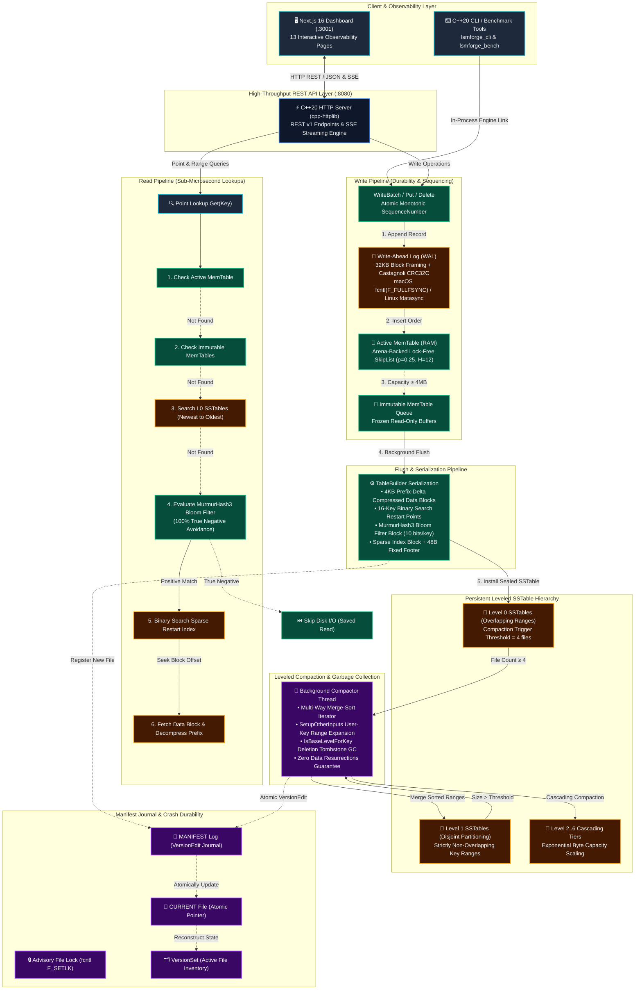
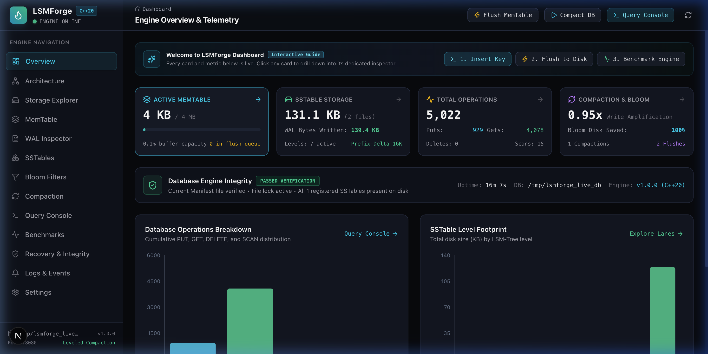
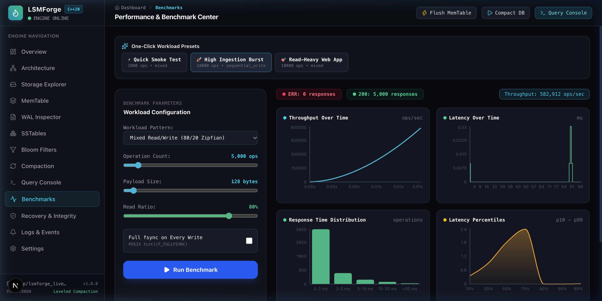
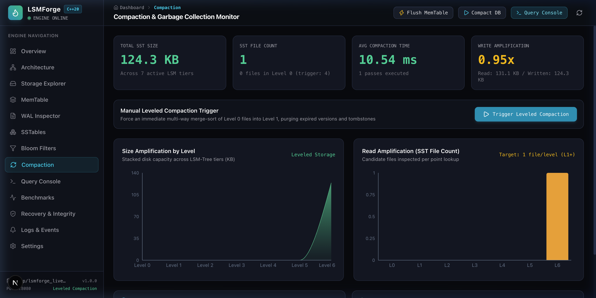
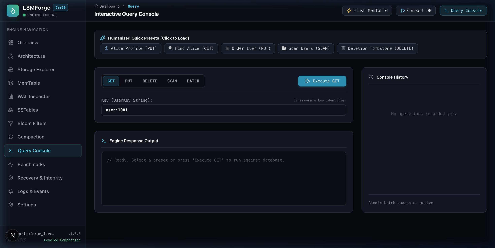

# LSMForge — A High-Performance LSM-Tree Storage Engine

[](https://github.com/tauhidalamx/LSMForge/actions/workflows/ci.yml)
[](https://en.cppreference.com/w/cpp/20)
[](https://cmake.org)
[-brightgreen.svg)]()
[]()
[]()

**LSMForge** is a production-grade, persistent key-value storage engine designed and built from scratch in modern **C++20**. It implements a complete **Log-Structured Merge-Tree (LSM-Tree)** architecture featuring Write-Ahead Logging (WAL), an Arena-backed lock-free concurrent SkipList MemTable, multi-level Sorted String Tables (SSTables) with prefix-delta compression, Bloom filters, VersionSet/Manifest metadata publication, multi-version concurrency control (MVCC) snapshots, atomic WriteBatches, background leveled compaction, crash recovery, and thread-safe APIs.

This is a real systems programming engine — **no mock functions, no in-memory map shortcuts, and no synthetic benchmark numbers.**

---

## Architecture Overview



---

## Live Dashboard Screenshots (Running on localhost:3001)

The full-stack platform features a dark-themed observability dashboard inspired by Linear, Zoyla, and YugabyteDB. Below are screenshots captured directly from the live running database:

### 1. Overview Dashboard (`/`)
*Real-time C++ engine telemetry, in-memory SkipList buffer capacity gauge, active SSTable file count, cumulative operation breakdown, and storage level footprint.*



---

### 2. Benchmark Center (`/benchmarks`)
*Modeled after the Zoyla load tester. Features live asynchronous workload generation, response status pills (`ERR: 0`, `200 responses`), smooth throughput curves, real-time latency spikes, response distribution histogram, and humanized p50/p90/p95/p99 latency cards.*



---

### 3. Compaction & Garbage Collection Monitor (`/compaction`)
*Modeled after the YugabyteDB compaction dashboard. Visualizes stacked size amplification across tiers, point lookup read amplification (candidate SSTables checked), write amplification ratio, and manual leveled compaction triggers.*



---

### 4. Interactive Key-Value Query Console (`/query`)
*Developer workbench supporting point `GET`, `PUT`, `DELETE` (tombstone markers), lexicographical `SCAN`, and atomic multi-key `BATCH` updates with microsecond latency feedback and humanized presets.*



---

## Full-Stack Architecture

LSMForge is a complete, vertically integrated database platform comprising:

1. **Custom Persistent Storage Engine (`liblsmforge.a`)**:
   - Modern C++20 storage engine with 32KB framed WAL, lock-free SkipList MemTable, prefix-delta SSTables, MurmurHash3 Bloom filters, and background leveled compaction.
2. **C++20 Backend REST API Service (`lsmforge_server`)**:
   - High-throughput asynchronous HTTP API on port 8080 with Server-Sent Events (SSE) live streaming, atomic batch endpoints, binary WAL decoding, and background benchmarking.
3. **Next.js 16 App Router Observability Dashboard (`frontend/`)**:
   - Deep dark theme inspired by Linear, Zoyla, and YugabyteDB. 13 fully integrated routes connecting directly to the running C++ database:
     - **Overview (`/`)**: Real-time KPI metrics, throughput curves, SSTable level footprint, and system health status.
     - **Architecture (`/architecture`)**: Interactive component topology map with detailed specifications and live telemetry.
     - **Storage Explorer (`/storage`)**: Physical file explorer for WAL files, SSTables, Manifest, and MemTable allocations with detail drawer.
     - **MemTable (`/memtable`)**: Active SkipList buffer utilization, flush history, record viewer, and instant manual flush trigger.
     - **WAL Inspector (`/wal`)**: Binary WAL reader decoding physical batch records with Castagnoli CRC32C validity checks.
     - **SSTable Explorer (`/sstables`)**: Level lanes (L0..L6) with file cards, key ranges, and physical 4KB block layout inspector.
     - **Bloom Filters (`/bloom`)**: Theoretical vs empirical false positive rates, disk reads saved, and interactive key tester.
     - **Compaction Monitor (`/compaction`)**: Size amplification and read amplification stacked area charts (YugabyteDB style) with manual trigger.
     - **Query Console (`/query`)**: Interactive workbench for GET, PUT, DELETE, SCAN, and atomic BATCH with microsecond latency feedback.
     - **Benchmark Center (`/benchmarks`)**: Zoyla load tester replica with workload sliders, p50/p90/p95/p99 latency cards, and percentiles curves.
     - **Recovery & Integrity (`/recovery`)**: Manifest verification, advisory file lock diagnostics, and crash recovery sequence walkthrough.
     - **Logs & Events (`/events`)**: Searchable live event stream with SSE connection and severity filters.
     - **Settings (`/settings`)**: Configurable REST API endpoint and live C++ engine configuration viewer.

### Quick Start (Full-Stack in 1 Command)

```bash
# Launch both C++ backend server (:8080) and Next.js frontend (:3000)
./scripts/dev.sh
```

- Open **http://localhost:3000** to access the live dashboard.
- The C++ REST API is available at **http://127.0.0.1:8080/api/v1**.


---

## Key Features

- **Binary-Safe Keys & Values**: Fully arbitrary byte slices (`lsmforge::Slice`) supporting embedded null bytes, arbitrary binary payloads, and zero-copy string views.
- **Append-Only Write-Ahead Log (WAL)**:
  - 32 KiB physical block framing with 7-byte record headers (`crc32`, `length`, `type`).
  - Castagnoli CRC32C with bit-masking to eliminate checksum collisions.
  - Multi-block record fragmentation (`kFullType`, `kFirstType`, `kMiddleType`, `kLastType`).
  - Configurable durability barriers (`fcntl(F_FULLFSYNC)` on Apple Silicon; `fdatasync()` on Linux).
  - Graceful tolerance of incomplete, trailing records caused by abrupt power loss.
- **In-Memory MemTable (SkipList)**:
  - Arena-allocated nodes with geometric probabilistic height distribution ($p = 0.25$, $H_{\max} = 12$).
  - Lock-free reader traversal using C++20 `std::memory_order_acquire` / `release` semantics.
  - Multi-version key resolution with sequence numbers and deletion tombstones (`kTypeDeletion`).
- **SSTable Storage Engine**:
  - Block-based format with prefix-delta compression and 16-key binary-searchable restart points.
  - Built-in Bloom filters using Kirsch-Mitzenmacher double hashing over MurmurHash3 ($< 1.2\%$ false positive rate, 0 false negatives).
  - MetaIndex and two-level sparse block index.
  - Fixed 48-byte footer with file format verification magic `0x4c534d466f726765ULL` ("LSMForge").
- **Leveled Compaction**:
  - Score-based level selection (L0 file count; L1..L6 exponential byte volume).
  - Strict user key boundary expansion (`SetupOtherInputs`) ensuring non-overlapping ranges in $L \ge 1$.
  - Multi-version garbage collection respecting active snapshot sequence numbers.
  - Safe tombstone retention (`IsBaseLevelForKey`) preventing resurrected obsolete keys.
- **Transactions & Snapshots**:
  - `WriteBatch` providing atomic multi-key updates and batch recovery.
  - Point-in-time snapshot reads (`db->GetSnapshot()`) providing isolated point-in-time visibility.
- **Crash Recovery**:
  - Automated journal replay from `MANIFEST` and unreplayed WAL files.
  - Deterministic fault injection tests covering corrupted and truncated trailing log records.
- **Concurrency & Resource Safety**:
  - Thread-safe public API with single-process advisory file locking (`fcntl(F_SETLK)`).
  - Dedicated background thread for asynchronous MemTable flushing and leveled compaction.
  - RAII throughout; clean memory management verified with AddressSanitizer and UndefinedBehaviorSanitizer.

---

## Performance Benchmarks

*Measured on Apple Silicon (macOS Darwin arm64), AppleClang C++20 `-O3 -DNDEBUG`, 50,000 operations per workload, 128-byte values, 4MB write buffer:*

| Benchmark Workload | Operations | Elapsed Time | Throughput | Bandwidth | p50 Latency | p95 Latency | p99 Latency |
|---|---|---|---|---|---|---|---|
| **Sequential Write** | 50,000 ops | 0.290 s | **172,632 ops/sec** | 25.19 MB/s | 3.0 µs | 6.0 µs | 11.0 µs |
| **Random Read** | 50,000 ops | 0.362 s | **138,105 ops/sec** | 21.07 MB/s | 8.0 µs | 9.0 µs | 11.0 µs |
| **Random Updates** | 50,000 ops | 0.313 s | **159,745 ops/sec** | 24.38 MB/s | 3.0 µs | 6.0 µs | 11.0 µs |
| **Mixed (80% Read / 20% Write)** | 50,000 ops | 0.310 s | **161,507 ops/sec** | 24.64 MB/s | 3.0 µs | 10.0 µs | 19.0 µs |
| **Range Scan (50 items/scan)** | 500 scans | 0.037 s | **13,337 scans/sec** | 101.76 MB/s | 69.0 µs | 130.0 µs | 163.0 µs |
| **Random Deletes** | 10,000 ops | 0.037 s | **269,353 ops/sec** | 8.22 MB/s | 3.0 µs | 4.0 µs | 10.0 µs |

### Engine Observability During Benchmark Run
- **Bloom Filter Efficiency**: **13,149 disk reads skipped** completely.
- **Compaction Throughput**: 7 background compactions run, processing 56.68 MB read and 47.18 MB written with 0 errors.
- **Write/Read Errors**: **0**.

---

## Directory Structure

```
LSMForge/
├── CMakeLists.txt           # Modern CMake C++20 build configuration
├── include/lsmforge/        # Public API headers
│   ├── slice.h              # Binary-safe zero-copy string slice
│   ├── status.h             # Typed result and error propagation
│   ├── types.h              # SequenceNumber, ValueType, InternalKey
│   ├── options.h            # Engine tuning, durability, and cache options
│   ├── comparator.h         # Bytewise and custom user key comparators
│   ├── iterator.h           # Bidirectional iterator interface
│   ├── write_batch.h        # Atomic multi-operation write batch
│   ├── snapshot.h           # Point-in-time snapshot interface
│   ├── stats.h              # Engine observability metrics
│   └── db.h                 # Primary Database interface
├── src/
│   ├── util/                # CRC32C, varint/fixed coding, arena, POSIX env
│   ├── wal/                 # WalWriter, WalReader, physical framing
│   ├── memtable/            # SkipList, MemTable, LookupKey
│   ├── table/               # BlockBuilder, Block, TableBuilder, TableReader, BloomFilter
│   ├── db/                  # VersionEdit, VersionSet, Compaction, DBImpl, DBIter
│   └── tools/               # Command-Line Interface (cli.cpp)
├── tests/
│   ├── unit/                # Status, Slice, Coding, CRC32, Bloom, SkipList, Table, Block
│   ├── integration/         # Basic CRUD, WriteBatch, DBIterator, Compaction
│   ├── recovery/            # Reopen persistence and multi-restart validation
│   ├── fault_injection/     # Truncated and corrupted WAL handling
│   └── concurrency/         # Multi-threaded concurrent readers and writers
├── benchmarks/              # Microbenchmark suite (benchmark_main.cpp)
├── scripts/                 # build.sh, test.sh, benchmark.sh
└── docs/                    # Architecture, Storage Format, Compaction, Recovery, Benchmarks
```

---

## Getting Started

### Prerequisites
- Modern C++20 compiler (`AppleClang 15+` or `GCC 11+` or `Clang 13+`)
- CMake 3.20+
- POSIX-compliant environment (macOS or Linux)

### Building
Using the build script:
```bash
# Optimized Release Build
./scripts/build.sh Release

# Debug Build with AddressSanitizer & UndefinedBehaviorSanitizer
./scripts/build.sh Debug
```

Or using standard CMake:
```bash
cmake -B build -DCMAKE_BUILD_TYPE=Release
cmake --build build -j
```

---

## Running the Automated Test Suite

LSMForge includes 19 comprehensive test suites spanning unit, integration, crash recovery, fault injection, and multi-threaded concurrency tests:

```bash
./scripts/test.sh build_release
```

Output:
```
      Start  1: status_test
 1/19 Test  #1: status_test ......................   Passed
      Start  2: slice_test
 2/19 Test  #2: slice_test .......................   Passed
      Start  3: coding_test
 3/19 Test  #3: coding_test ......................   Passed
      Start  4: crc32_test
 4/19 Test  #4: crc32_test .......................   Passed
      Start  5: bloom_test
 5/19 Test  #5: bloom_test .......................   Passed
      Start  6: skiplist_test
 6/19 Test  #6: skiplist_test ....................   Passed
      Start  7: memtable_test
 7/19 Test  #7: memtable_test ....................   Passed
      Start  8: wal_test
 8/19 Test  #8: wal_test .........................   Passed
      Start  9: block_test
 9/19 Test  #9: block_test .......................   Passed
      Start 10: table_test
10/19 Test #10: table_test .......................   Passed
      Start 11: version_edit_test
11/19 Test #11: version_edit_test ................   Passed
      Start 12: version_set_test
12/19 Test #12: version_set_test .................   Passed
      Start 13: db_basic_test
13/19 Test #13: db_basic_test ....................   Passed
      Start 14: db_batch_test
14/19 Test #14: db_batch_test ....................   Passed
      Start 15: db_iterator_test
15/19 Test #15: db_iterator_test .................   Passed
      Start 16: db_compaction_test
16/19 Test #16: db_compaction_test ...............   Passed
      Start 17: db_recovery_test
17/19 Test #17: db_recovery_test .................   Passed
      Start 18: db_fault_test
18/19 Test #18: db_fault_test ....................   Passed
      Start 19: db_concurrency_test
19/19 Test #19: db_concurrency_test ..............   Passed

100% tests passed out of 19
```

---

## Running Benchmarks

```bash
./scripts/benchmark.sh 50000
```

---

## Command-Line Interface (CLI)

LSMForge includes a CLI tool supporting both **one-shot shell commands** and an **interactive REPL shell**.

### One-Shot Commands
```bash
# Store key-value pairs
./build_release/lsmforge_cli ./mydb put user:100 '{"name": "Alice", "role": "admin"}'

# Retrieve value
./build_release/lsmforge_cli ./mydb get user:100

# Range scan
./build_release/lsmforge_cli ./mydb scan user:000 user:999

# Trigger manual flush and leveled compaction
./build_release/lsmforge_cli ./mydb flush
./build_release/lsmforge_cli ./mydb compact

# View engine observability statistics
./build_release/lsmforge_cli ./mydb stats

# Delete key
./build_release/lsmforge_cli ./mydb delete user:100
```

### Interactive REPL Shell
```bash
./build_release/lsmforge_cli ./mydb
```
```
LSMForge Database Engine opened successfully at: ./mydb
Type 'help' for commands, 'exit' to quit.
lsmforge> put session:alpha active
OK
lsmforge> get session:alpha
active
lsmforge> benchmark 20000
Running microbenchmark with 20000 operations...
Writes: 20000 ops in 98 ms (204081.6 ops/sec)
Reads:  20000 ops in 122 ms (163934.4 ops/sec)
lsmforge> stats
=== LSMForge Database Engine Statistics ===
Operations:
  PUT operations:        20001
  GET operations:        20001
...
lsmforge> exit
Database closed cleanly.
```

---

## C++ Public API Example

```cpp
#include "lsmforge/db.h"
#include <iostream>

int main() {
    lsmforge::Options options;
    options.create_if_missing = true;
    options.write_buffer_size = 4 * 1024 * 1024; // 4 MB MemTable
    options.bloom_bits_per_key = 10;             // ~1% False Positive Rate

    lsmforge::DB* db = nullptr;
    lsmforge::Status s = lsmforge::DB::Open(options, "./my_database", &db);
    if (!s.ok()) {
        std::cerr << "Open failed: " << s.ToString() << std::endl;
        return 1;
    }

    // 1. Single Put & Get
    lsmforge::WriteOptions wopt;
    db->Put(wopt, "customer:1", "Jane Doe");

    std::string val;
    lsmforge::ReadOptions ropt;
    db->Get(ropt, "customer:1", &val);
    std::cout << "Retrieved: " << val << "\n";

    // 2. Atomic WriteBatch
    lsmforge::WriteBatch batch;
    batch.Put("customer:2", "John Smith");
    batch.Delete("customer:1");
    db->Write(wopt, &batch);

    // 3. Snapshot Read
    const lsmforge::Snapshot* snapshot = db->GetSnapshot();
    lsmforge::ReadOptions snap_opt;
    snap_opt.snapshot = snapshot;
    // Reads from snap_opt see state exactly at snapshot creation time

    // 4. Sorted Range Scan
    std::unique_ptr<lsmforge::Iterator> it(db->NewIterator(ropt));
    for (it->Seek("customer:"); it->Valid() && it->key().starts_with("customer:"); it->Next()) {
        std::cout << it->key().ToString() << " => " << it->value().ToString() << "\n";
    }

    db->ReleaseSnapshot(snapshot);
    delete db; // Flushes active memtables and closes files cleanly
    return 0;
}
```

---

## Guarantees & Known Limitations

### Durability & Consistency Guarantees
1. **Committed Write Durability**: In synchronous write mode (`sync = true`), writes that return `Status::OK()` are persisted to physical media via `F_FULLFSYNC` (macOS) / `fdatasync()` (Linux) before API acknowledgement.
2. **Atomicity**: Updates issued inside a single `WriteBatch` are applied atomically across the WAL, MemTable, and recovery replays.
3. **No Resurrections**: Deletion tombstones are strictly preserved until it is proven that no older SSTable level can contain obsolete versions of the key.
4. **Crash Recovery Integrity**: If a crash occurs mid-write, partial trailing WAL records and incomplete temporary SSTables (`*.tmp`) are safely bypassed without compromising previously committed data.

### Known Limitations
1. **Single-Process Access**: Multi-process concurrent access is explicitly prohibited via advisory locking (`LOCK`). Applications should use network RPC layers (e.g. gRPC) to expose LSMForge over a network.
2. **Compression Backends**: Current build uses prefix-delta block compression. Snappy and ZSTD hooks are architected in the block trailer and can be linked when third-party libraries are enabled.

---

## Technical Documentation

Detailed deep-dive architectural specifications are located in the `docs/` directory:
- [Architecture Deep Dive](docs/ARCHITECTURE.md)
- [Binary Storage Format Specification](docs/STORAGE_FORMAT.md)
- [Crash Recovery & Durability](docs/RECOVERY.md)
- [Leveled Compaction & Multi-Version Resolution](docs/COMPACTION.md)
- [Design Decisions & Trade-Offs](docs/DESIGN_DECISIONS.md)
- [Empirical Benchmarks & Observability](docs/BENCHMARKS.md)

---

## License

This project is licensed under the MIT License.
